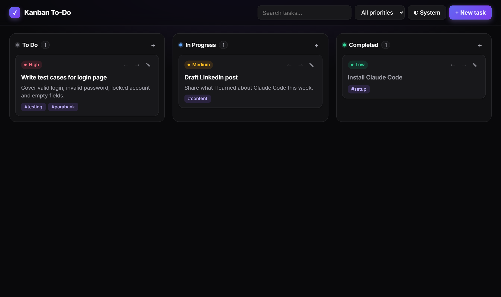
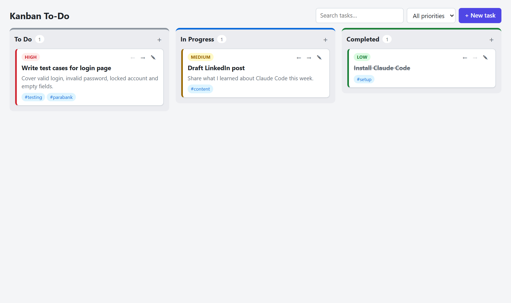

# One-Prompt Apps

**Apps and content built with Claude Code from a single prompt, then improved through short follow-ups and a multi-agent review.**

**[▶ Live demo](https://YOUR-USERNAME.github.io/one-prompt-apps/)**

| React + Vite (dark theme) | Plain HTML/CSS/JS |
|---|---|
|  |  |

## How the Kanban app was built

**1. One prompt.** I described what I wanted in plain English:

> I would like to create and develop a To Do List Web Application that uses a Kanban board to track the progress of the To Do's. By default, there will be three columns: To Do, In Progress, Completed. To Do items should have all of the basic details like the title, a description, a priority, tags.

Claude Code planned it in Plan mode and built [`kanban-todo/`](kanban-todo): a working board in plain HTML, CSS and JavaScript that needs no install.

**2. Move to React.** A follow-up asked for a React version: [`kanban-react/`](kanban-react), with Vite, custom hooks for state and theme, and one component per part of the screen.

**3. Re-theme.**

> Please consider the color theme of application from most trending web applications and styles.

The result was a zinc and indigo→violet palette in the style of Linear, Vercel and shadcn/ui, with a System/Light/Dark toggle.

**4. Multi-agent review.** From a second chat:

> Please can you use three deep dive agents to review your implementation? Please ensure that it is actually complete and that there aren't any bugs or massive gaps.

Three reviewers confirmed every feature worked, and found real bugs:

- One bad saved task blanked the whole board on every load.
- Selecting text and letting go outside the edit window closed it and lost changes.
- Keyboard focus was lost after Save, Cancel or Delete.

All three are fixed. For example, [`useTodos.js`](kanban-react/src/hooks/useTodos.js) now checks and repairs each task as it loads, and a corrupt save is backed up instead of crashing the app.

**What I took from it:** a single prompt gets you a working app fast, but **review agents found bugs I wouldn't have spotted by clicking around**. "Build, then send agents to break it" is now how I work.

## Features

- Three columns with task counts
- Title, description, priority (High/Medium/Low) and tags on each task
- Drag and drop between and within columns, plus ← → buttons for touch and keyboard
- Search, a priority filter, and click-a-tag to filter
- Saved in localStorage and kept in sync across tabs
- System/Light/Dark theme
- Keyboard shortcuts: **N** for a new task, **Enter** to edit

## Run locally

```bash
cd kanban-react
npm install
npm run dev
```

For the plain version, open `kanban-todo/index.html` in a browser.

## Content system

The same lesson also produced a **reusable brand-voice skill**, [`content-system/brand-voice/SKILL.md`](content-system/brand-voice/SKILL.md). It records audience, tone, structure, emoji and hashtag rules, a "never" list, and a pre-publish checklist, so every post sounds the same without re-explaining it. It lives in `~/.claude/skills/`, so Claude loads it in any project whenever I ask for a post. [`content-system/`](content-system) also has the LinkedIn and X drafts it wrote from one research prompt.

## Deployment

[`.github/workflows/pages.yml`](.github/workflows/pages.yml) builds the React app and publishes both versions to GitHub Pages on every push to `main`.

---

Part of my Claude Code learning series: see [agentic-qa-parabank](https://github.com/YOUR-USERNAME/agentic-qa-parabank) and [claude-code-learning-journal](https://github.com/YOUR-USERNAME/claude-code-learning-journal).
